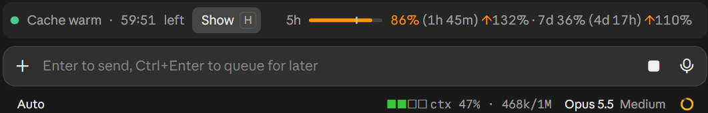

# prompt-gauges

Two small Claude Code mods for keeping an eye on how much room you have left: one for the context window, one for the 5-hour and 7-day usage limits. They work in the terminal and in the desktop app's Code tab.



*Above the prompt, limit-band (right) beside Cache Maxxer's band (left); in the footer, context-label beside the model name.*

> **Cache Maxxer is not part of this repository.** The prompt-cache countdown on the left of the screenshot is [Cache Maxxer](https://github.com/vayaan-labs/cache-maxxer) by Vayaan Labs, a separate mod. Install it from there if you want it too; limit-band shares the row with it when it is installed and takes the row by itself when it is not. These mods work without it.

## Install with an AI agent

Give your coding agent (Claude Code, for example) this repository's URL and ask it to install the mods. The steps below are written for that agent.

> **For the agent installing these mods.** Ask the user before each step that installs anything.
>
> 1. Ask which mods they want: **context-label** (context fill in the prompt footer), **limit-band** (the 5-hour and 7-day usage limits above the prompt; it shows only on a subscription with usage limits), or both.
> 2. Ask whether they also want **Cache Maxxer** (the prompt-cache countdown, a separate mod by Vayaan Labs, not maintained here). Say plainly that it is someone else's mod; skip it if they say no.
> 3. Install from a shell, in this order (limit-band before Cache Maxxer, so the two share one row):
>    ```
>    claude plugin install context-label --marketplace pdrive/prompt-gauges
>    claude plugin install limit-band --marketplace pdrive/prompt-gauges
>    claude plugin install cache-maxxer --marketplace vayaan-labs/plugins
>    ```
>    Leave out the lines for what they declined.
> 4. If Cache Maxxer was already installed before limit-band, the two land on separate lines: in `~/.claude/settings.json`, move `"limit-band@prompt-gauges"` above `"cache-maxxer@vayaan-labs"` in `enabledPlugins`, with the user's OK.
> 5. Tell the user to run `/reload-plugins` (or start a new session), and that the settings are in `/config` (`context-label.*`, `limit-band.*`; see the sections below).
> 6. In the desktop app, where a shell is not at hand, the same is: **+** next to the prompt box → **Plugins** → **Add marketplace** `pdrive/prompt-gauges` → **Add plugin**.

## context-label

The context window's fill, always visible in the prompt footer beside the model name, instead of behind a click:

```
■☐☐☐ ctx 23% · 228k/1M        Opus 5.5  Medium
```

- **The bar** is four squares over the whole window. A square fills once you are within 5 points of it: at 20%, 45%, 70% and 95%.
- **The color** of the filled squares says how much you should care:

  | Color  | From (defaults) | Why |
  |--------|-----------------|-----|
  | green  | 0 | |
  | yellow | half the window (500k of 1M), or 100k on Haiku | each turn resends the whole context; Haiku 5.5's price per token goes up 5x for prompts over 100k; the other Claude 4.6-and-later models price the full 1M window the same ([pricing](https://platform.claude.com/docs/en/about-claude/pricing#long-context-pricing)) |
  | orange | 72% of the way to auto-compact (about 700k) | getting close |
  | red    | 93% of the way to auto-compact (about 900k) | auto-compact is near, which can break a chat |

  Orange and red follow your session's auto-compact point (read from Claude Code, as `/context` shows it); with auto-compact off they follow the whole window.
- **The text** is the same figures as the app's own context popover, updated after every response. A fresh or just-compacted session shows nothing until its first response.

Settings, with `/config`. The thresholds take any whole number from 0 to 100, and 0 turns a level off:

```
/config context-label.yellow_at=50          # % of the window
/config context-label.orange_at=72          # % of the way to auto-compact
/config context-label.red_at=93             # % of the way to auto-compact
/config context-label.haiku_price_step=true # yellow at 100k on Haiku 5.5
/config context-label.show=bar and text|bar|text
```

The levels are checked from red down and the first that is reached wins, so they never overlap: a lower level set above a higher one simply never shows.

## limit-band

A thin line above the prompt for the 5-hour usage window, with its percent and time to reset, and the 7-day window beside it:

```
5h ━━━━━━━━┃━━──────────  49% (2h 56m) ↑119% · 7d 31% (4d 18h)
```

The bar is colored by **pace**, not by how full it is. 49% used sounds fine, but if only 41% of the window has gone by, you are on course to hit the limit before it resets. So:

- **projected** = used % ÷ the share of the window gone by;
- **green** while on pace, **orange** from a projected 100%;
- near the top the used share wins whatever the pace: **orange** from 60% used, **red** from 90% (red is kept for that; red by pace is a setting, off by default);
- in the text, the 5-hour percent is colored by how full it is (green, orange from 60%, red from 90%) and each hint's `↑` by its window's pace; the numbers after it, the times and the 7-day percent stay dim;
- `↑119%` shows the projection once it reaches the orange pace setting (100% by default), for the 7-day window too; its arrow is orange, or red past the red pace setting;
- the **tick** on the bar marks where the window's clock is: a fill past the tick is ahead of pace;
- no projection in the first tenth of a window, when it would be noise; only the used floors apply then.

The percents come from the last API response; the countdowns tick on their own. It shows only on a subscription with usage limits.

Settings, with `/config` (the defaults are the values above). Any whole number, 0 is off; the levels are checked from red down, so they never overlap:

```
/config limit-band.orange_used=60    # % used, 0 to 100
/config limit-band.red_used=90       # % used, 0 to 100
/config limit-band.orange_pace=100   # % projected, 0 to 500
/config limit-band.red_pace=0        # % projected, 0 to 500 (off by default)
```

Pace coloring is an idea from [PCritchfield/claude-gauges](https://github.com/PCritchfield/claude-gauges) (MIT), whose status line and session pane color plan limits the same way; this is its own implementation for the band above the prompt.

It shares its row with [Cache Maxxer](https://github.com/vayaan-labs/cache-maxxer)'s band when that mod is installed (and moves under it while Cache Maxxer's detail is open); without it, it takes the row by itself. It also gives that band fixed-width digits, so its ticking seconds don't nudge the row. The row works when limit-band is drawn around Cache Maxxer's band, which follows the order of `enabledPlugins` in `~/.claude/settings.json`: if the two land on separate lines, list `limit-band@prompt-gauges` before `cache-maxxer@vayaan-labs` there and run `/reload-plugins`.

## Install

At the prompt of a Claude Code terminal session:

```
/plugin install context-label --marketplace pdrive/prompt-gauges
/plugin install limit-band --marketplace pdrive/prompt-gauges
```

Answer `y` to add the marketplace, then pick a scope. From a shell:

```
claude plugin install context-label --marketplace pdrive/prompt-gauges
claude plugin install limit-band --marketplace pdrive/prompt-gauges
```

In the desktop app: click **+** next to the prompt box, then **Plugins**, **Add marketplace** with `pdrive/prompt-gauges`, then **Add plugin**.

## Working on the mods

Each mod is a Claude Code hooks module under `plugins/<mod>/`: `.claude-plugin/plugin.json` (the manifest and its `/config` settings), `hooks/register.tsx` (the module), `types/index.d.ts` (its state contract and shared types) and `tests/*.test.ts`. `.claude-plugin/marketplace.json` lists them.

To run your changes, add a local clone as a marketplace and install from it; Claude Code then reads the mods from the clone, and an edit plus `/reload-plugins` reloads them:

```
claude plugin marketplace add <path to your clone>
claude plugin install context-label@prompt-gauges
claude plugin install limit-band@prompt-gauges
```

Before a commit:

1. `claude plugin validate .` and `claude plugin validate plugins/<mod>`.
2. `claude plugin test plugins/<mod>` for each mod changed, with the tests updated for the new behaviour.
3. Bump the mod's `version` in its `plugin.json` for a change people should get.
4. Keep this README in step: what each mod shows, its colors and thresholds, its settings.

Limits of the desktop app worth knowing:

- **The prompt footer (context-label)** draws text only: an `Svg` is dropped, a `Button` loses the colors, sibling `Text`s are spaced apart (nest them in one `Text`), and the slot is cut at a fixed width. Keep it short.
- **The band above the prompt (limit-band)** shares one row with Cache Maxxer's band, with little room to spare: anything added to its text can push Cache Maxxer onto two lines. The shared row needs limit-band listed before Cache Maxxer in `enabledPlugins` (a reinstall appends it at the end and splits the row).
- **No `isInteractive` on the bar's `Svg`.** The interactive frame a `<title>` tooltip needs reloads on every redraw, so the bar flashes with every countdown tick.
- **A number that ticks** (a countdown, a percentage) wants `tabular` on its `Text`, so it doesn't change width.

Keep docs, comments and commit messages about the mods themselves, and credit ideas taken from other projects here.

## License

MIT
